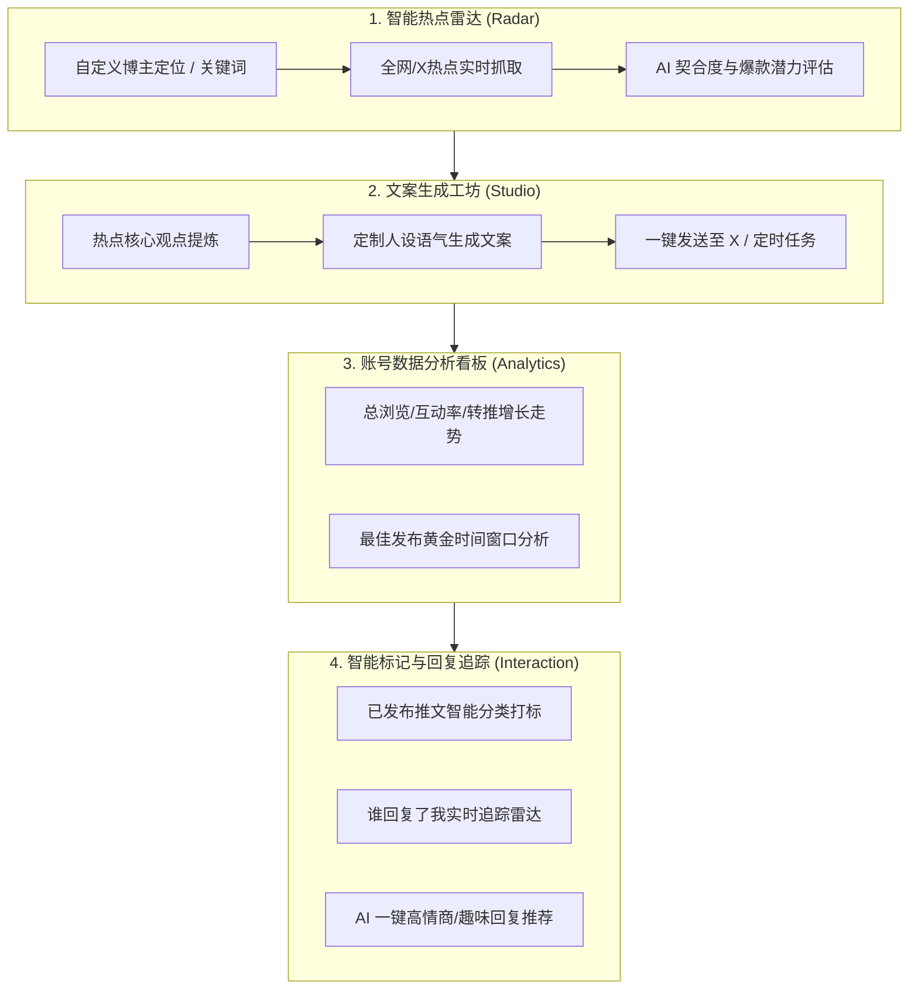

# ❄️ FuyuPulse（冬雪脉冲）- X 账号智能热点与自动化运营系统方案

## 1. 账号权限与连接现状解答

> [!IMPORTANT]
> **当前状态回答：我现在暂时无法直接在后台凭空访问你的个人 X 账号。**
> 
> **为什么？**
> X (Twitter) 属于私密社交平台，读取未公开数据（如详细数据分析、完整回复追踪、以你的身份发布推文）需要你的专属鉴权凭证（如 **X API OAuth 2.0 / API Key** 或 **本地授权 Session**）。当前环境中尚未绑定任何 X 账号。
> 
> **系统如何解决接入问题？**
> 在搭建好的系统中，我们将提供 **双模接入方案**：
> 1. **官方 API / OAuth 接入**：在系统设置中填入 X Developer 凭证，一键授权，即可打通数据分析、粉丝与回复监控、一键/定时直接发帖。
> 2. **智能仿真 / 演示沙盒模式（Demo Mode）**：即使尚未申请 API，系统也内置完整的全链路功能模拟与公开数据检索，你可以立即体验热点发现、文案生成与交互看板。

---

## 2. 视觉设计系统（参考冬日雪景动漫美学）

系统 UI 将严格提取你提供的插画作为全局核心视觉基调：

### 🎨 配色与视觉语言

| 视觉元素 | 设计参数 | 视觉意象与用途 |
| :--- | :--- | :--- |
| **霜雪主色** | `#F8FAFC` ~ `#EEF2F6` | 纯净清透的雪景底色，卡片微光 |
| **冰晶灰蓝** | `#94A3B8` ~ `#CBD5E1` | 冷调文字、副标题与图表网格线 |
| **围巾绯红（Accent）** | `#C06C84` ~ `#B85270` | 提取自少女围巾的高级豆沙绯粉，用于按钮、热度标识、重点高亮 |
| **夜墨缎带** | `#1E293B` ~ `#0F172A` | 提取自发带蝴蝶结的沉稳黑灰，用于重点文字与深色交互 |
| **毛玻璃质感** | `backdrop-blur-xl bg-white/40` | 半透明磨砂亚克力面板，带有细微雪霜反光边框 |
| **环境特效** | Canvas 粒子雪花 | 背景轻柔飘落的微粒雪花，支持自由开启/关闭动效 |

---

## 3. 核心功能架构

---

## 4. 核心功能模块详细设计

### 模块一：热点雷达与契合度筛选（Hotspot Radar）
- **自定义人设档案（Persona Profile）**：设定你的核心领域（如：AI 工具前沿、二次元生活、独立开发、泛科技数码等），设定口吻与立场。
- **热点瀑布流**：实时抓取 X 趋势、科技早报与热搜，AI 给每条热点打出 **「匹配度 0-100%」** 和 **「吸睛角度建议」**。

### 模块二：AI 爆款文案生成器（Copywriting Studio）
- **多版本裂变**：针对一条热点，生成三种风格版本（例如：深度犀利专业型、轻松互动二次元软萌型、锐评玩梗型）。
- **推文配图建议**：结合文案自动推荐契合冬日美学或科技氛围的视觉配图风格。
- **发布队列**：支持「立即发布」与「排期发送（Schedule）」。

### 模块三：推文智能打标与内容看板（Smart Content Tagging）
- 对所有发布过的帖子自动进行 **多维标签化**（如 `#热点追踪`、`#教程干货`、`#日常互动`、`#观点输出`）。
- **打标 ROI 分析**：直观展示哪个标签带来的曝光最多、涨粉效率最高。

### 模块四：互动追踪与谁回复了我（Replies & Mentions Tracker）
- **互动监控看板**：实时流式查看所有回复你帖子的用户、头像、回复内容与情绪偏向（正向、提问、反驳）。
- **高价值用户识别**：标注高粉丝量账号或常互动“铁粉”。
- **AI 辅助快回**：点击推文一键生成 3 条不同语气的回评草稿，点击即可秒回。

---

## 5. 项目工程规划（严谨遵守非 C 盘存放规范）

- **项目存储路径**：`E:\Projects\fuyupulse-x-manager\`
- **技术栈**：
  - **前端**：React 18 + Vite + TailwindCSS + Lucide Icons + Canvas 雪花微动效
  - **后端**：Node.js Express / Python FastAPI 服务端（对接 X API v2 + 大模型生成文案）
  - **数据存储**：轻量级 SQLite / JSON 存储，支持持久化历史推文与分析报表
